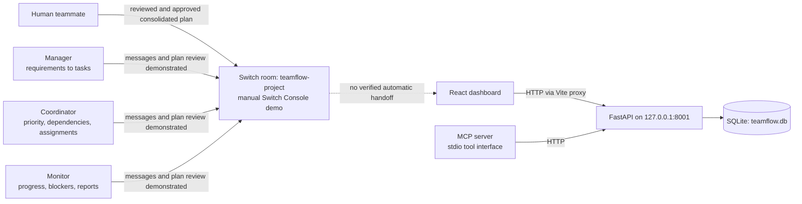

# TeamFlow AI

TeamFlow AI is a hackathon prototype for coordinating project work with three AI teammates: Manager, Coordinator, and Monitor. In a manual demonstration through Switch Console, the agents collaborated in a shared room, reviewed a project plan, and a human approved the consolidated plan. The repository also contains a dashboard backed by a project and task API.

> **Prototype status:** The Switch agent collaboration and human review were demonstrated manually in Switch Console. The repository contains a FastAPI/SQLite task backend, a React dashboard, and an MCP server that defines five API-backed tools. The Switch configuration is not stored here, and the connection between Switch agents, MCP, and automatic database task operations has not been verified. Agents should not be assumed to create or update database tasks. See [Current implementation and limits](#current-implementation-and-limits).

## Why TeamFlow

Project work often gets split across planning conversations, task boards, and status updates. TeamFlow gives specialized AI teammates clear responsibilities while keeping a person in control of consequential plans and assignments. The Manager, Coordinator, and Monitor were created in Switch Console and added to the shared `teamflow-project` room, where they successfully exchanged messages and reviewed a project plan. A human reviewed and approved the consolidated plan. This collaboration was demonstrated manually; its Switch configuration is not stored in this repository.

## Architecture



The repository-backed data path is the dashboard or an MCP client calling the FastAPI backend, which reads and writes project and task records in SQLite. During local development, Vite proxies dashboard API requests to `http://127.0.0.1:8001`. The MCP server is implemented to call that same API at port **8001**; it does not access SQLite directly. The MCP connection to the Switch agents and automated task operations from agent collaboration have not been verified.

### How Switch fits

The three agents were created in Switch Console and added to the shared room `teamflow-project`. In a manual demonstration, they exchanged messages, reviewed a project plan, and a human reviewed and approved their consolidated plan. This collaboration was carried out through Switch Console; the room and agent configuration is not stored in this repository. There is no checked-in Switch integration code or verified automatic handoff from the room to the dashboard, MCP server, or database. No Switch commands or setup steps are documented here because the repository does not contain verified configuration for them.

## AI teammate roles

These are the demonstrated Switch agent roles. The collaboration described below was run manually in Switch Console; corresponding agent definitions, prompts, and orchestration are not stored in this repository.

| Teammate | Intended responsibility | Human checkpoint |
| --- | --- | --- |
| **Manager** | Breaks project requirements into proposed tasks and contributes to project plan review. | A human reviewed and approved the consolidated plan in the manual demonstration. |
| **Coordinator** | Prioritizes tasks, identifies dependencies, and proposes assignments as part of the shared plan. | Proposed assignments remain subject to human review; automatic assignment into the database is unverified. |
| **Monitor** | Tracks progress and blockers and contributes status/reporting context to the collaboration. | Automatic monitoring from database events or task updates is not verified. |

## What is implemented

- **FastAPI backend:** project and task endpoints, input validation, status and priority values, and project summary reports.
- **SQLite database:** `teamflow.db` is created in the repository root when the backend starts. No separate database service is required.
- **React dashboard:** browse projects, view tasks and summary metrics, create tasks, filter by status, and update task status.
- **MCP server:** `agents.mcp_server` defines `list_projects`, `list_tasks`, `create_task`, `update_task_status`, and `generate_project_report`. It is implemented to call the backend over HTTP at `127.0.0.1:8001`; connection to Switch agents and automatic tool use by those agents have not been verified.

## Windows setup and run

Prerequisites: Python 3.10 or newer, Node.js with npm, and Windows PowerShell. Run commands from the repository root unless a step says otherwise.

### 1. Install backend dependencies

```powershell
py -m venv .venv
.venv\Scripts\Activate.ps1
python -m pip install -r requirements.txt
```

If PowerShell blocks virtual environment activation, either allow local scripts for your user according to your environment's policy, or skip activation and use `.venv\Scripts\python.exe` in place of `python` in the following commands.

### 2. Start the API

In the first PowerShell terminal, start FastAPI on port **8001** (the port expected by both the dashboard proxy and MCP server):

```powershell
python -m uvicorn app.main:app --reload --host 127.0.0.1 --port 8001
```

Open `http://127.0.0.1:8001/docs` for the interactive API documentation. The database is initialized at `teamflow.db` on startup and is ignored by Git.

### 3. Start the dashboard

In a second terminal, from the repository root:

```powershell
cd frontend
npm install
npm run dev
```

Open the URL Vite prints, usually `http://localhost:5173`. The dashboard uses Vite's development proxy to reach the API on port 8001. Create a project with the API before using the dashboard if the database has no projects yet; project creation is currently available through `POST /projects`, not through the dashboard UI.

For a quick project setup from PowerShell while the API is running, use:

```powershell
$project = Invoke-RestMethod -Method Post `
  -Uri 'http://127.0.0.1:8001/projects' `
  -ContentType 'application/json' `
  -Body '{"name":"Hackathon Demo","description":"TeamFlow sample project"}'
$project
```

### 4. Run the MCP server (optional)

With the API still running on port 8001, open a third terminal at the repository root, activate the same virtual environment, then run:

```powershell
python -m agents.mcp_server
```

The server uses the MCP Python SDK and FastMCP. Its `mcp.run()` entry point relies on the SDK's default transport; a connection from Switch agents to this server has not been verified. Configure it in an MCP-compatible host using that host's documented settings. No host-specific configuration is included in this repository. Although the MCP server defines tools that can create tasks or update task status, this does not mean the Switch agents invoke them; automatic agent-driven database operations have not been verified. The MCP server itself does not implement the three AI teammates or an approval gate.

## Demo workflow

1. Start the API on port 8001 and the Vite dashboard as described above.
2. Create a demo project using the PowerShell request above, or use `POST /projects` in `/docs`.
3. Refresh the dashboard and select the project. Show the project summary and task list.
4. Use **New task** to add a task with a title, assignee, due date, priority, and status.
5. Change the task status in the dashboard and show the refreshed progress summary.
6. Optionally connect an MCP-compatible host to the MCP server and demonstrate `list_projects`, `list_tasks`, or `generate_project_report`. `create_task` and `update_task_status` change data, so use them only when you intend to modify the demo database.
7. For the agent collaboration portion, demonstrate the Manager, Coordinator, and Monitor exchanging messages and reviewing a plan in Switch Console. Show the human reviewing and approving the consolidated plan. This is a manual Switch Console demonstration; the Switch configuration and the agent-to-MCP/database integration are not contained in this repository.

## API overview

| Method | Path | Purpose |
| --- | --- | --- |
| `GET` | `/` | Backend health message |
| `POST` | `/projects` | Create a project |
| `GET` | `/projects` | List projects |
| `POST` | `/projects/{project_id}/tasks` | Create a task |
| `GET` | `/projects/{project_id}/tasks` | List a project's tasks |
| `PATCH` | `/tasks/{task_id}` | Update task fields |
| `DELETE` | `/tasks/{task_id}` | Delete a task |
| `GET` | `/projects/{project_id}/report` | Get task totals, status counts, and overdue count |

Task due dates use `YYYY-MM-DD`. Priorities are `Low`, `Medium`, or `High`; statuses are `Pending`, `In Progress`, `Blocked`, or `Completed`.

## Repository map

- `app/main.py` — FastAPI app and database startup
- `app/routes.py` — project, task, and report endpoints
- `app/schemas.py` — request and response validation models
- `app/database.py` — SQLite connection and schema initialization
- `agents/mcp_server.py` — MCP tools that call the HTTP API
- `frontend/src/App.jsx` — dashboard interface and interactions
- `frontend/src/api.js` — frontend API requests
- `frontend/vite.config.js` — Vite development proxy to port 8001

## Current implementation and limits

- Manager, Coordinator, and Monitor collaboration in Switch Console has been demonstrated manually: the agents exchanged messages, reviewed a project plan, and a human approved the consolidated plan. Their configuration and prompts are not stored in this repository.
- No Switch integration code or room setup is checked in. The `teamflow-project` room was configured and used in Switch Console, but repository setup cannot reproduce it.
- The human approval described above occurred in the manual collaboration. There is no approval workflow in the FastAPI backend or dashboard, which currently allow task creation and status updates directly.
- The MCP server implementation defines backend tools and expects the API at `127.0.0.1:8001`. Its connection to Switch agents, end-to-end MCP client setup, and agent-triggered database operations have not been verified. Do not assume agents create or update database tasks automatically.
- The backend and dashboard provide project/task CRUD and reporting, but there is no authentication or multi-user permission layer in this prototype.
